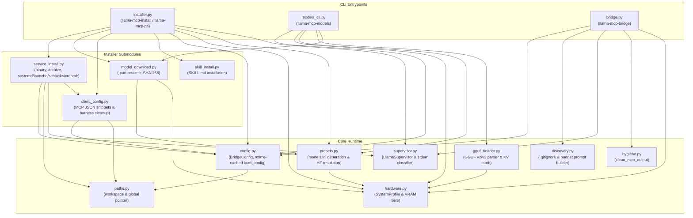

# Architecture — `llama-mcp-bridge`

`llama-mcp-bridge` separates **orchestration & MCP exposure** (`bridge.ini` / Python FastMCP server) from **model serving & preset execution** (`models.ini` / `llama-server --models-preset` router mode).

## Module Call Graph

## Request & Data Flow

1. **Tool Registration:** At startup, `bridge.py` (`_register_configured_tools`) reads `models.ini` under a re-entrant lock (`_TOOL_REG_LOCK`) and exposes only configured presets (plus `get_bridge_status` and `ask_preset`).
2. **Context Assembly:** When a tool is called with `file_paths`, `discovery.py` expands files, directories, and globs with `include > (.gitignore + ignore + DEFAULT_IGNORES)` precedence, sorts smallest-first, and truncates cleanly within `max_total_chars`.
3. **Lazy Supervision:** `bridge.py` invokes `LlamaSupervisor.ensure_running()`, which checks `/health` and auto-spawns `llama-server --models-preset <models.ini>` on demand, streaming output to `llama-server.log` and a bounded stderr tail.
4. **Inference & Hygiene:** Requests hit `http://<host>:<port>/v1/chat/completions` with `"stream": false`. Responses pass through `hygiene.py` (`clean_mcp_output`) to strip reasoning traces without corrupting nested code blocks or LaTeX.
5. **Failure Classification & OOM Fallback:** On HTTP 500/503 or transport failure, `supervisor.py` (`classify_inference_error`) inspects the captured `llama-server` `stderr` tail to distinguish VRAM/RAM OOM from timeouts and, when `fallback_on_oom = true`, retries text-only on `digest`.
