# Architecture — `llama-mcp-bridge`

`llama-mcp-bridge` separates **orchestration & MCP exposure** (`bridge.ini` / Python FastMCP server) from **model serving & preset execution** (`models.ini` / `llama-server --models-preset` router mode).

## Module Call Graph

```mermaid
flowchart TD
    subgraph CLI["CLI Entrypoints"]
        INSTALL["installer.py<br/>(llama-mcp-install / llama-mcp-ps)"]
        MODELS["models_cli.py<br/>(llama-mcp-models)"]
        CFGCLI["config_cli.py<br/>(llama-mcp-config)"]
        BRIDGE["bridge.py<br/>(llama-mcp-bridge)"]
    end

    subgraph InstallerModules["Installer & Diagnostics"]
        SVC["service_install.py<br/>(binary, archive, systemd/launchd/schtasks/crontab)"]
        DL["model_download.py<br/>(.part resume, SHA-256)"]
        CLIENT["client_config.py<br/>(MCP JSON snippets & harness cleanup)"]
        SKILL["skill_install.py<br/>(SKILL.md installation)"]
        OLLAMA["ollama_import.py<br/>(manifest parser & blob symlinker)"]
        DIAG["diagnostics.py<br/>(--profile, --selftest, --export/--diff-config)"]
        SIGN["signing.py<br/>(cosign/gpg release verification)"]
        HTTP["http_resilience.py<br/>(backoff, circuit breaker, ENOSPC/EMFILE)"]
        LOG["logging_utils.py<br/>(text & JSON log formatter)"]
    end

    subgraph Core["Core Runtime"]
        CFG["config.py<br/>(BridgeConfig, mtime+bytes cached load_config)"]
        PATHS["paths.py<br/>(workspace, global & named pointers)"]
        HW["hardware.py<br/>(SystemProfile & VRAM tiers)"]
        PRESETS["presets.py<br/>(models.ini generation & HF resolution)"]
        GGUF["gguf_header.py<br/>(GGUF v2/v3 parser & KV math)"]
        DISC["discovery.py<br/>(.gitignore & budget prompt builder)"]
        SUP["supervisor.py<br/>(LlamaSupervisor & stderr classifier)"]
        HYG["hygiene.py<br/>(clean_mcp_output)"]
        MET["metrics.py<br/>(Prometheus /metrics & /healthz sidecar)"]
    end

    INSTALL --> SVC & DL & CLIENT & SKILL & OLLAMA & DIAG
    INSTALL --> CFG & HW & PRESETS & SUP
    MODELS --> CFG & HW & PRESETS & GGUF & DL & OLLAMA
    CFGCLI --> CFG
    OLLAMA --> GGUF & PRESETS & HW
    DIAG --> CFG & GGUF & PRESETS & HW & SUP
    BRIDGE --> CFG & DISC & SUP & HYG & HW & MET & PATHS
    SVC --> CFG & PATHS & SUP & CLIENT & SIGN
    DL --> PRESETS & HW
    CLIENT --> CFG & PATHS
    CFG --> PATHS
    PRESETS --> HW
    GGUF --> HW
```

## Request & Data Flow

1. **Tool Registration & Hot-Reload:** At startup, `bridge.py` (`_register_configured_tools`) reads `models.ini` under `_TOOL_REG_LOCK`, filters by `allowed_presets`, and exposes configured presets plus `get_bridge_status`, `ask_preset`, and `ask_batch`. Subsequent `models.ini` changes trigger `check_and_reload_models_ini()` and emit `notifications/tools/list_changed`.
2. **Context Assembly & Warmup:** When a tool is called with `file_paths`, `discovery.py` expands files, directories, and globs with `include > (.gitignore + ignore + DEFAULT_IGNORES)` precedence, sorts smallest-first, and truncates cleanly within `max_total_chars`. Optional `--warmup` preloads configured presets asynchronously on startup.
3. **Lazy Supervision & Auth:** `bridge.py` invokes `LlamaSupervisor.ensure_running()`, which checks `/health` and auto-spawns `llama-server --models-preset <models.ini>` (with `--api-key` when configured), streaming output to `llama-server.log` and a bounded stderr tail.
4. **Inference, Streaming & Hygiene:** Requests hit `http://<host>:<port>/v1/chat/completions` with `"stream": false` or `"stream": true` (SSE token accumulation) and per-call `timeout_s`, emitting `notifications/progress` after 30s. Responses pass through `hygiene.py` (`clean_mcp_output`), while `metrics.py` records counters and latency histograms for `GET /metrics`.
5. **Failure Classification & OOM Fallback:** On HTTP 500/503 or transport failure, `supervisor.py` (`classify_inference_error`) inspects the captured `llama-server` `stderr` tail to distinguish VRAM/RAM OOM from timeouts and, when `fallback_on_oom = true`, retries text-only on `digest`.
